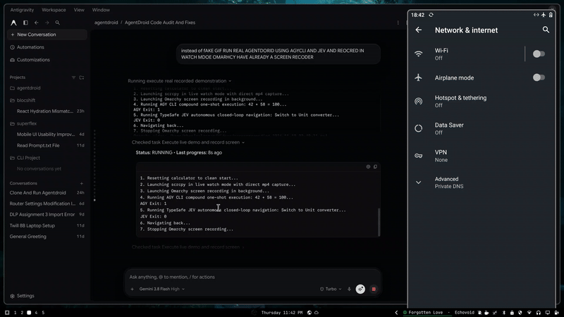

# AgentDroid

A silent, ultra-fast headless **Android computer for AI coding agents**, built on [Redroid](https://github.com/remote-android/redroid-doc) with an accessibility driving engine based on [Google Artemis](https://github.com/google/artemis).



- **Native MCP & CLI for AI Agents:** Claude Code, Google Antigravity (`agy`), OpenAI Codex, Cursor, and Windsurf drive Android directly via standard Model Context Protocol (MCP) over stdio or compound CLI calls.
- **Zero Cloud LLM Keys Required:** The core runtime is 100% local. Your existing AI coding assistant is the brain — zero third-party Python runtime dependencies, zero per-minute sandbox fees, and zero cloud lock-in.
- **Optional Cloud Dynamic Agent (`agentdroid ai`):** If you explicitly run `agentdroid ai "<goal>"`, it connects to TypeSafe AI (`https://api.typesafe.ai/v1`) requiring `TYPESAFE_API_KEY`. All core MCP and compound CLI workflows remain 100% local.
- **Single-Turn Compound Execution:** AI agents execute end-to-end tasks in **one shot** (`launch` → `wait-any` → `if-visible` → `fill` → `capture` → `{{var}}` → `assert-text`) without turn-by-turn LLM latency or token waste.
- **Ultra-Fast Local Peripherals:** In-process `/dev/uinput` daemon (`InputDaemon`) and native accessibility tree dumping (`~16 ms`) deliver compact structured JSON (`~400–600` tokens, filtering soft keyboard noise) saving **85%+ tokens** over raw XML and screenshots.
- **Dual Operating Modes:** Run silently in the background (`--headless`) for autonomous pipelines, or launch a live floating phone window (`agentdroid watch` / `scrcpy`) to monitor actions in real time.
- **Built-in Security Hardening:** Optional `--safe` mode blocks arbitrary root shell execution, enforces command allowlisting, and mandates HTTPS + SHA-256 integrity verification for APK installations.

---

## Architecture

```
┌──────────────────────────────────────────────────────────────────┐
│  AI Agents (Claude Code · Antigravity / agy · Cursor · Codex)   │
└────────────────────────────────┬─────────────────────────────────┘
                                 │ stdio MCP (JSON-RPC) or CLI (-d)
                                 ▼
┌──────────────────────────────────────────────────────────────────┐
│  agentdroid Runtime (Python stdlib + optional Rust accelerator)  │
│  - Compound Pipeline & One-Shot Evaluator                        │
│  - Security Sandbox & Safe-Mode Enforcer                         │
│  - Native MCP Stdio Server                                       │
└────────────────────────────────┬─────────────────────────────────┘
                                 │ ADB SmartSocket (127.0.0.1:5555)
                                 ▼
┌──────────────────────────────────────────────────────────────────┐
│  Redroid Container (Android 11 / Linux Kernel)                   │
│  ├── InputDaemon (Port 18889: direct /dev/uinput injection)      │
│  ├── Artemis Accessibility Helper (Port 23244: compact a11y dump)│
│  └── Silent System Configuration (audio=0, anim=0, dark=1)       │
└──────────────────────────────────────────────────────────────────┘
```

---

## Quick Start & Installation

### Instant Agent Setup Prompt (Copy & Paste)

If you are using an AI coding assistant (Claude Code, Google Antigravity `agy`, Cursor, Codex, Windsurf), copy and paste this prompt directly into chat:

```text
Please set up and verify AgentDroid on my system so you can drive a headless Android phone:

1. Check if AgentDroid is installed (`which agentdroid`). If not, install and configure it:
   curl -fsSL https://raw.githubusercontent.com/theajmalrazaq/agentdroid/v0.3.0/install.sh | bash -s -- --yes
   (Or if already inside the repo: ./install.sh --yes)
2. Boot the headless Android container and configure silent settings:
   agentdroid up
3. Register the AgentDroid MCP server and skills for yourself:
   agentdroid mcp --install
   agentdroid setup --agents-only
4. Verify system and peripheral health:
   agentdroid doctor
5. Once `agentdroid doctor` reports green, notify me that the Android device is online and ask what Android task, app installation, or workflow you should perform!
```

---

### Requirements
- **OS:** Linux (x86_64 or aarch64) with kernel support for `binder` and `ashmem` (standard on modern Ubuntu, Debian, Arch Linux, Fedora).
- **Host Tools:** Docker with Docker Compose, `adb` (`android-tools`), and Python 3.10+.
- **Optional Tools:** `scrcpy` (required only for `--watch` live visual overlay), Rust/Cargo (for building optional `agentdroid-fast`).

### Option 1: Pinned One-Line Installer (Recommended)

Run the installer non-interactively to clone, configure kernel modules, set up permissions, and mount agent rules:

```bash
curl -fsSL https://raw.githubusercontent.com/theajmalrazaq/agentdroid/v0.3.0/install.sh | bash -s -- --yes
```

To run interactively with step-by-step confirmation prompts:

```bash
curl -fsSL https://raw.githubusercontent.com/theajmalrazaq/agentdroid/v0.3.0/install.sh | bash
```

### Option 2: Clone & Local Setup

```bash
git clone https://github.com/theajmalrazaq/agentdroid.git
cd agentdroid

# Run the automated installer:
./install.sh --yes

# Or start manually:
docker compose up -d redroid
agentdroid provision
agentdroid doctor
```

### Option 3: Python Package (`pip` / `pipx`)

```bash
# In an active virtualenv or via pipx:
pip install -e .

# Start the device:
docker compose up -d redroid
agentdroid provision
```

### Verify Setup

Run the built-in diagnostic suite:

```bash
agentdroid doctor
```
```
AgentDroid Doctor (127.0.0.1:5555)
  • Host Tools:           adb=True, scrcpy=True, binder=True, uinput=True
  • Device Connected:     True (root=True, silent_provisioned=True)
  • Accessibility Helper: reachable (v1.2.0)
  • Bundled Helper APK:   SHA-256 verified
  • Input Daemon (18889): reachable
```

---

## Connecting AI Agents

AgentDroid is purpose-built to let existing AI coding agents drive an Android phone without extra API keys or custom wrapper scripts.

### 1. Claude Code & Claude Desktop

Mount AgentDroid's Model Context Protocol (MCP) server directly into Claude:

```bash
# Automatically configure Claude Code (~/.claude.json):
agentdroid mcp --install --agent claude
```

Or configure manually in `~/.claude.json` (Claude Code) or `~/.config/claude/claude_desktop_config.json` (Claude Desktop):

```json
{
  "mcpServers": {
    "agentdroid": {
      "command": "agentdroid",
      "args": ["mcp", "--safe"]
    }
  }
}
```

**How Claude drives the phone:** Claude receives native tools (`mobile_run_workflow`, `mobile_get_device_state`, `mobile_perform_action`, `mobile_action_burst`). In a single prompt, tell Claude:
> *"Install Markor from F-Droid, open it, create a new note called 'meeting.md', type 'Discuss Q3 roadmap', and save."*

Claude calls `mobile_run_workflow` in **one turn** and receives the completed result.

---

### 2. Google Antigravity (`agy`) & Gemini Jetski

Install AgentDroid skills and rules into Antigravity:

```bash
# Mount skills into ~/.gemini/skills/ and rules into ~/.gemini/GEMINI.md:
agentdroid setup --agents-only

# Register AgentDroid in Antigravity's MCP config:
agentdroid mcp --install --agent antigravity
```

**How Antigravity drives the phone:**
Antigravity can drive AgentDroid through two primary channels:
1. **Direct One-Shot CLI:** Antigravity runs one bash command via `run_command`:
   ```bash
   agentdroid --headless --safe --launch org.fossify.math \
     -d "click:4" -d "click:2" -d "click:+" -d "click:5" -d "click:8" -d "click:=" \
     --assert-text "100" --json
   ```
2. **MCP Server:** Registered in `~/.gemini/jetski/mcp_config.json`, allowing direct tool calls (`mobile_run_workflow`).

---

### 3. Cursor IDE

Install AgentDroid MCP server and project rules into Cursor:

```bash
agentdroid mcp --install --agent cursor
```

This writes:
- `.cursor/mcp.json`:
  ```json
  {
    "mcpServers": {
      "agentdroid": {
        "command": "agentdroid",
        "args": ["mcp", "--safe"]
      }
    }
  }
  ```
- `.cursor/rules/agentdroid.mdc`: Guides Cursor to invoke one-shot compound actions instead of fragmented shell scripts.

---

### 4. OpenAI Codex CLI

```bash
agentdroid mcp --install --agent codex
```

Appends the configuration to `~/.codex/config.toml`:

```toml
[mcp_servers.agentdroid]
command = "agentdroid"
args = ["mcp", "--safe"]
```
Rules are automatically upserted into `~/.codex/AGENTS.md`.

---

### 5. Windsurf

Running `agentdroid setup --agents-only` automatically adds AgentDroid operating invariants to `~/.codeium/windsurf/memories/global_rules.md`. Windsurf can then drive AgentDroid via the local CLI or MCP stdio server.

---

## Operating Invariants: The One-Shot Rule

Agents driving AgentDroid follow **three core principles** defined in [`AGENTS.md`](AGENTS.md):

1. **One-Shot Direct Execution (Never Create Scripts):**
   Agents should never write throwaway `.py` / `.sh` scripts or execute multi-turn loops (`dump → click → dump → type`). The full sequence is specified in a single call via `mobile_run_workflow` or `agentdroid -d ...`.
2. **Zero Redundant Screenshots:**
   Accessibility hierarchy dumps (`agentdroid ui dump --json`) take `~16 ms` and consume `~400–600` tokens with IME noise filtered out. Screenshots should only be used when navigating pure canvas/OpenGL interfaces without accessibility nodes.
3. **Single-Call Cross-App Data Flow:**
   Use `capture:<var>=<regex>` and `{{var}}` interpolation to extract data from one app and inject it into another within the same execution call:

```bash
# Read a confirmation token from an email app and paste it into a settings field in 1 call:
agentdroid --headless --safe \
  --launch "com.example.mail" \
  -d "wait-text:Verification Code" \
  -d "capture:code=Code:\\s*([0-9]{6})" \
  -d "open-url:myapp://settings/verify" \
  -d "wait-text:Enter Code" \
  -d "fill:code_input={{code}}" \
  -d "click:btn:Submit" \
  --assert-text "Verified" \
  --json
```

### Choosing the Right Execution Strategy

> [!TIP]
> - **For deterministic or known app flows:** `agy cli` / MCP **One-Shot Compound Execution** is the fastest path (~1.3 s execution, 0 extra LLM turns).
> - **For unknown, branching, or dynamic UIs:** **TypeSafe JEV** provides sub-second closed-loop recalibration per step, but requires an active TypeSafe API key.

---

## CLI Reference & Cheat Sheet

### Common Commands

```bash
# Start and provision the device:
agentdroid up

# Check status and component health:
agentdroid doctor

# Open live floating phone overlay (scrcpy):
agentdroid watch

# Install an app from F-Droid:
agentdroid app install fdroid:org.fossify.calculator

# Install an app from a local APK:
agentdroid app install ./app.apk

# Dump compact UI tree in JSON:
agentdroid ui dump --json

# Push and pull files:
agentdroid device push ./local.txt /sdcard/Download/remote.txt
agentdroid device pull /sdcard/Download/output.txt ./output.txt

# Stop the device:
agentdroid down
```

### Compound Workflow Verbs (`-d` / `--do`)

Compound flags can be chained in order to perform multi-step workflows:

| Verb | Syntax Example | Description |
| :--- | :--- | :--- |
| `click` | `-d "click:btn:Save"` / `-d "click:#3"` | Click by button label, text, resource ID, or element index. |
| `fill` | `-d "fill:edit:Search=Query"` | Clear and set text into an editable target. |
| `append` | `-d "append:\nNew line"` | Append text to the end of a document or text field. |
| `wait-text`| `-d "wait-text:Ready@5"` | Wait up to 5s for text to appear on screen. |
| `wait-any` | `-d "wait-any:Done\|Error\|Cancel@10"` | Wait for any of multiple alternatives to appear. |
| `wait-gone`| `-d "wait-gone:Loading"` | Wait for a loading spinner or modal to disappear. |
| `if-visible`| `-d "if-visible:Allow->click:btn:Allow"`| Conditionally execute an action if a needle is present. |
| `capture` | `-d "capture:id=ID:\\s*(\\w+)"` | Extract regex match into `{{var}}` for subsequent steps. |
| `open-url` | `-d "open-url:https://news.ycombinator.com"`| Open a URL or Android deep link (`app://...`). |
| `scroll` | `-d "scroll:down"` / `-d "scroll-to:Settings"` | Scroll vertically/horizontally or scroll until text is visible. |
| `key` | `-d "key:ENTER"` / `-d "key:BACK"` | Send standard Android hardware keycodes. |
| `hide-keyboard`| `-d "hide-keyboard"` | Dismiss the soft keyboard if currently visible. |

---

## Security Model

AgentDroid runs inside a local privileged Docker container with ADB bound strictly to `127.0.0.1`.

- **Safe Mode (`--safe` or `AGENTDROID_SAFE_MODE=1`):**
  Blocks arbitrary root ADB shell access across `run`, `pipeline`, `device shell`, and `mcp`. Commands must be explicitly allowed via `--shell-allowlist` (or `AGENTDROID_SHELL_ALLOWLIST`), and shell chaining metacharacters (`;`, `&&`, `|`, `$(`, `` ` ``) are rejected.
- **HTTPS & SHA-256 APK Verification:**
  Insecure `http://` APK downloads are rejected. Remote APK downloads are cached with SHA-256 sidecars and validated against `--sha256 <hex>` or inline `sha256:<hex>@https://...`.
- **Bundled Helper Integrity:**
  The `ArtemisAccessibilityHelper.apk` binary is verified against `packages/artemis-accessibility-helper/helper_manifest.json` on startup and in `agentdroid doctor`.

---

## Repository Structure

```
agentdroid/
├── agentdroid/                 # Python engine, CLI commands, security, MCP server
│   ├── adb.py                  # ADB SmartSocket transport & shell executor
│   ├── cli.py                  # CLI dispatcher & subcommand routing
│   ├── daemon.py               # Persistent Unix-socket IPC daemon
│   ├── engine.py               # AndroidEngine & compound pipeline executor
│   ├── helper.py               # Artemis Accessibility client & parser
│   ├── installer.py            # Global skill, rule, and CLI installer
│   ├── mcp.py                  # Native stdio Model Context Protocol server
│   ├── pipeline.py             # Compound action pipeline execution
│   └── security.py             # Safe mode policy & APK checksum verification
├── bin/
│   └── agentdroid              # Standalone CLI executable symlinked to ~/.local/bin
├── docker/
│   ├── docker-compose.yml      # Redroid container definition (127.0.0.1:5555)
│   └── redroid/                # Silent agent configuration & container assets
├── packages/
│   └── artemis-accessibility-helper/  # Bundled helper APK & SHA-256 manifest
├── rust/                       # Optional Rust accelerator (agentdroid-fast)
├── scripts/
│   └── provision-device.sh     # Silent provisioning script
├── skills/
│   └── agentdroid/SKILL.md     # AgentDroid skill definition for AI agents
├── AGENTS.md                   # Agent operating rules & instructions
├── install.sh                  # Opt-in local installer script
├── LICENSE                     # Apache License 2.0
└── NOTICE                      # Third-party notices and attributions
```

---

## License & Credits

AgentDroid is licensed under the [Apache License 2.0](LICENSE). See [NOTICE](NOTICE) for third-party component attributions.

- **[Redroid](https://github.com/remote-android/redroid-doc):** Remote-Android team's containerized Android runtime.
- **[Google Artemis](https://github.com/google/artemis):** Accessibility Helper APK (Apache-2.0, Copyright Google LLC).
- **[TypeSafe AI](https://typesafe.ai):** Optional cloud dynamic exploration endpoint (`agentdroid ai`).

**Disclaimer:** AgentDroid is an independent open-source project and is not affiliated with, endorsed by, or sponsored by Google LLC.
